<div align="center">



<a href="https://tempo141.vercel.app"></a>
<a href="https://ficha141.vercel.app"></a>


</div>


```
> NOME ............ Luis
> STACK ........... JavaScript, Java, Python, PHP, C/C++, React, MySQL
> PROJETOS ........ Sites e app Android do Projeto 1.4.1, um RPG autoral
> STATUS .......... Aberto a oportunidades
```



<a href="https://tempo141.vercel.app"></a>
<a href="https://ficha141.vercel.app"></a>



<div align="center">

<sub><b><code>// LINGUAGENS</code></b></sub><br>


<br><br>

<sub><b><code>// FRAMEWORKS E BIBLIOTECAS</code></b></sub><br>


<br><br>

<sub><b><code>// BANCO DE DADOS E FERRAMENTAS</code></b></sub><br>


<br><br>

<sub><b><code>// INTELIGÊNCIA ARTIFICIAL</code></b></sub><br>

<br><br>

</div>


<div align="center">

</div>


