<div align="center">


<a href="https://tempo141.vercel.app"></a>
<a href="https://ficha141.vercel.app"></a>


</div>



```
> OPERADOR ........ Arthur // LuisHSA141
> FUNÇÃO .......... Criador e mestre do Projeto 1.4.1
> ESPECIALIDADE ... Sites e apps de suporte pro RPG
> FACÇÃO .......... Jormungand
> STATUS .......... EM CAMPO
```


<a href="https://tempo141.vercel.app"></a>
<a href="https://ficha141.vercel.app"></a>
<a href="https://github.com/wavezinkat/Ficha-Digital---POK-RPG-D-D-5E"></a>


<div align="center">


</div>



<div align="center">

</div>


